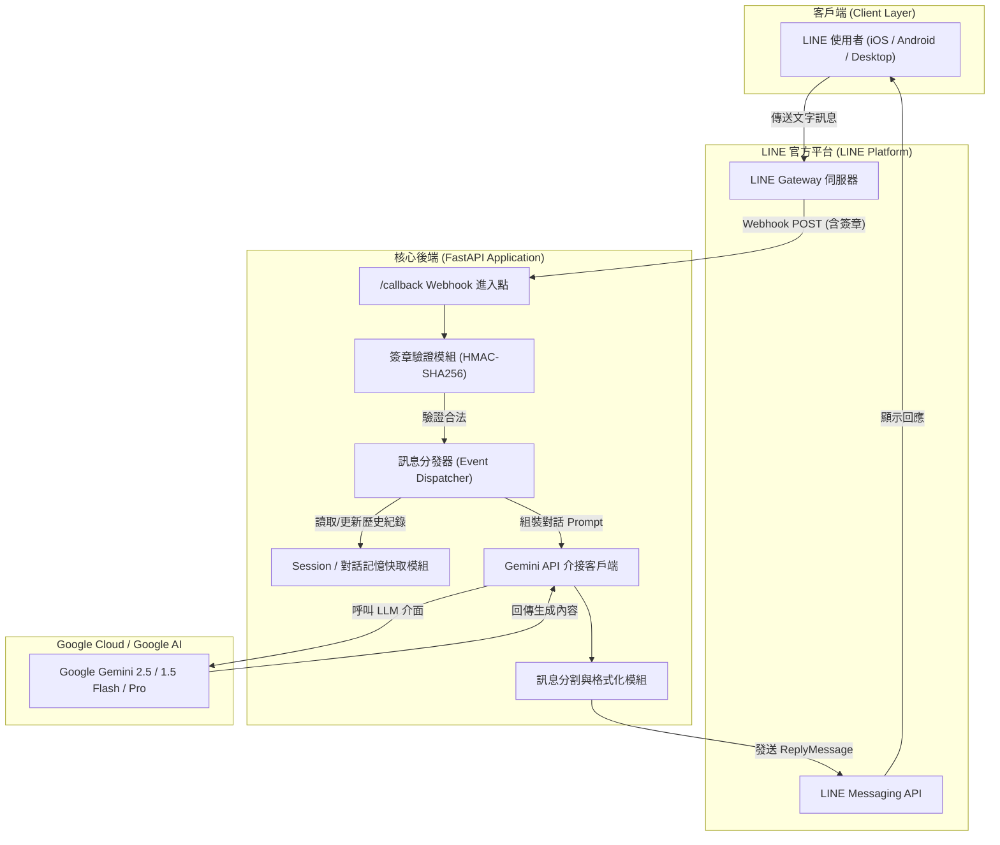
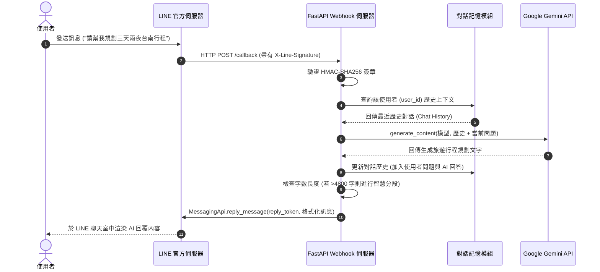
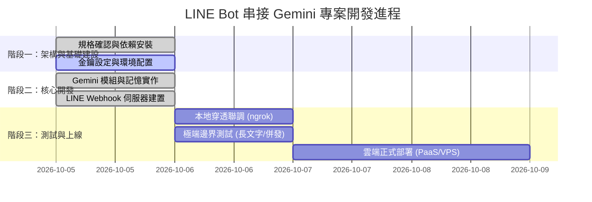

# 【專案計畫書】LINE 智慧對話機器人整合 Google Gemini 系統

---

## 摘要 (Executive Summary)

本專案旨在建置一套高效能、高擴展性之 **LINE 官方帳號（LINE Official Account）智慧對話助理**。透過整合最新版 **Google Gemini 大型語言模型（LLM）**，賦予機器人自然語言理解、邏輯推論、多輪對話記憶與長篇資訊彙整能力。使用者無需額外安裝專屬 App，即可在日常最熟悉的 LINE 通訊軟體中，享受全天候即時的 AI 智慧服務。

---

## 一、 專案背景與目標 (Project Background & Objectives)

### 1.1 現況痛點
- **傳統 LINE 機器人僵硬**：大部分基於關鍵字比對或固定問答樹（FAQ Tree），無法理解使用者自然的語意表達與上下文關聯。
- **維護成本高昂**：關鍵字規則需人工持續擴充與微調，面對生僻問答容易陷入「我不懂您的意思」的窘境。
- **跨平台使用門檻**：雖然市面上已有 ChatGPT、Gemini 等網頁工具，但長輩或非技術使用者在切換網頁或登入驗證時仍有使用摩擦。

### 1.2 專案預期目標
1. **即時語意理解**：利用 Gemini 先進模型，精確辨識使用者意圖並給予高質量解答。
2. **上下文多輪記憶**：具備短期對話記憶能力，能連貫上下文進行追問與討論。
3. **無縫整合體驗**：直接嵌入 LINE 生態圈，支援群組與個人一對一聊天。
4. **低延遲與高彈性**：採用非同步（Asynchronous）後端架構，確保 Webhook 於 3 秒內快速回應，避免 LINE 逾時重發。

---

## 二、 系統架構設計 (System Architecture)

### 2.1 系統總體拓撲圖 (Topology Diagram)

### 2.2 訊息處理時序圖 (Sequence Diagram)

---

## 三、 技術規格評估 (Technical Stack Evaluation)

| 元件層級 | 選用技術 | 選用評估與效益 |
| :--- | :--- | :--- |
| **後端語言** | **Python 3.13** | 本機原生環境，生態系成熟，具備最強大的 AI/LLM SDK 支援度。 |
| **API 框架** | **FastAPI + Uvicorn** | 基於 Starlette/Pydantic 的非同步 ASGI 框架，單機高併發吞吐量優異，內建 OpenAPI 規範。 |
| **通訊協定 SDK** | **LINE Messaging API SDK v3** | 官方最新 Python SDK，全面支援類型註解、新版訊息格式與驗證機制。 |
| **AI 核心引擎** | **Google GenAI SDK (`google-genai`)** | Google 官方統一版 SDK，直接支援 Gemini 2.5 / 1.5 系列，具備百萬級 Token 上下文與極速回應能力。 |
| **設定管理** | **python-dotenv** | 遵循 12-Factor App 原則，機敏金鑰與環境參數嚴格隔離。 |
| **網路穿透測試** | **ngrok / localtunnel** | 快速將本機 Localhost 暴露為具備 SSL/TLS 的合法公開端點。 |

---

## 四、 核心功能規格 (Functional Specifications)

### 4.1 對話與問答功能
- **全方位知識庫**：程式編程、語言翻譯、公文擬稿、摘要總結、創意發想等。
- **角色與人設控制**：支援透過 System Instruction 定義特定助理風格（如專業客服、幽默管家、英文導師等）。

### 4.2 對話記憶機制 (Multi-turn Chat Session)
- **滑動窗口記憶（Sliding Window）**：記錄每個使用者最近 10~12 輪問答，使對話自然延續。
- **手動清除指令**：使用者輸入 `/reset` 或 `清除對話`，立即重設對話歷程，保護隱私並省除舊有雜訊。

### 4.3 邊界防禦與異常容錯
- **超長訊息智慧分割**：LINE 單則訊息上限為 5,000 字元。系統內建分段器，在文字超過 4,800 字時自動分拆為多則有序訊息發送（單次回覆最多 5 則）。
- **模型故障轉移（Fallback Mechanism）**：當新一代模型遇流量配額限制時，自動嘗試切換至 `gemini-1.5-flash`，保障高可用性。
- **無效簽章防護**：非 LINE 官方送出的偽造封包一律回傳 `400 Bad Request` 並阻擋。

---

## 五、 資安與隱私防護 (Security & Privacy)

1. **通道傳輸加密**：全鏈路強制採用 HTTPS (TLS 1.3)，防止中間人竊聽（MITM）。
2. **簽章真偽校驗**：利用 LINE 提供之 `Channel Secret` 計算請求雜湊值，拒絕未授權存取。
3. **金鑰零洩漏原則**：
   - 所有 Token 與 API Key 僅留存於 `.env` 本地設定檔。
   - `.gitignore` 自動排除 `.env`，防止上傳至公開代碼庫。
4. **記憶數據隔離**：依據 LINE 派發之匿名 `user_id` 作為記憶隔離鍵，不同使用者之間絕不串供或洩露訊息。

---

## 六、 專案里程碑與實作時程 (Milestones & Roadmap)

---

## 七、 營運成本分析 (Cost Analysis)

| 服務項目 | 免費額度 / 計費標準 | 預估初期花費 |
| :--- | :--- | :--- |
| **Google Gemini API** | 每日免費提供數十萬 Token 額度 (Free Tier，足以應付數千則對話) | **\$0 元** |
| **LINE Official Account** | 免費方案每月提供 200 則主動推播（**使用者發問、機器人被動回覆不計入額度，完全免費**） | **\$0 元** |
| **伺服器託管** | 開發階段本機運行；未來若上線可部署於 Render / Zeabur / Fly.io 免費或低成本方案（約 \$0 ~ \$5/月） | **\$0 ~ \$150 台幣/月** |

---

## 八、 未來進階擴充願景 (Future Enhancements)

1. **多模態辨識（Multimodal）**：支援使用者傳送「圖片」或「語音訊息」，交由 Gemini 進行拍照辨識、發票記帳、圖像解題與語音聽寫。
2. **外部知識庫串接（RAG）**：串接向量資料庫（如 ChromaDB / Pinecone），匯入企業內部 PDF、手冊或私有資料，打造專屬業務客服機器人。
3. **數據持久化儲存**：將對話紀錄保存至 SQLite / PostgreSQL / Redis，即便伺服器重啟記憶亦不遺失。
